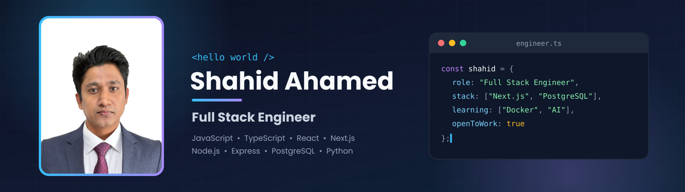
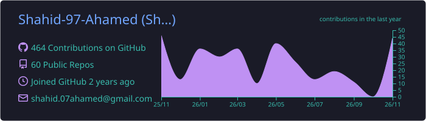
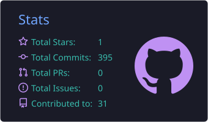
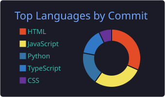

  
 <h1 align="center">Hi 👋, I'm Shahid Ahamed</h1> 
  
 
    

 ABOUT ME
💻 I'm a Full Stack Engineer who builds modern, scalable and type-safe web applications.
⚛️ Frontend: React.js, Next.js, TypeScript, Tailwind CSS, DaisyUI
🛠️ Backend: Node.js, Express.js, PostgreSQL, MySQL
🐍 Also comfortable with Python
🎓 Studied Web Engineering at Tokyo Multi AI College (2024 – 2026)
🏅 Certified: Web Creator Exam – Expert (2025)
📍 Based in Japan 🇯🇵
🌱 Currently learning NestJS, Drizzle ORM, Redis, Docker, AWS, CI/CD and AI Engineering (LLM, RAG, LangChain)
🏗️ Focused on System Design, Clean Code and Multi-Tenant SaaS architecture
💬 Ask me about JavaScript, TypeScript, React, Next.js, Node.js and SQL databases
📫 Reach me at shahid.07ahamed@gmail.com
 TECHNOLOGY STACK
💻 Languages

  

🎨 Styling & UI

   

⚛️ Frameworks & Libraries

  

🗄️ Databases

  

🧰 Tools & Platforms

  

🌱 CURRENTLY LEARNING
Backend & Database

   

DevOps & Deployment

  

AI Engineering

      

Software Engineering

     

 GITHUB STATISTICS & ANALYSIS
GitHub Contributions

  

GitHub Statistics

  
 
   

Streak

  

💡 RANDOM DEV QUOTE

  

  
 
<i>⭐ Thanks for visiting! Feel free to check out my repositories.</i>

